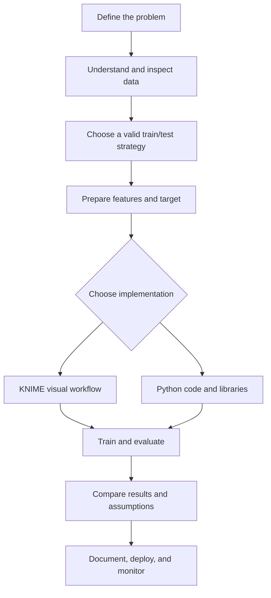
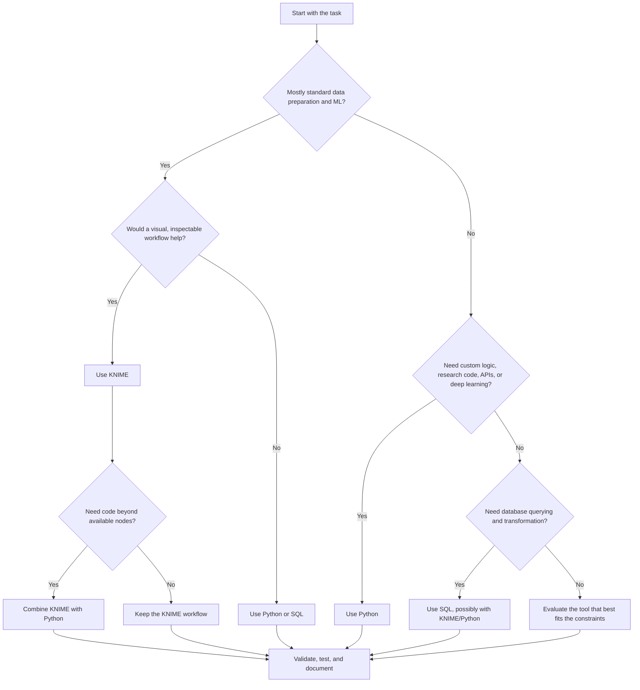
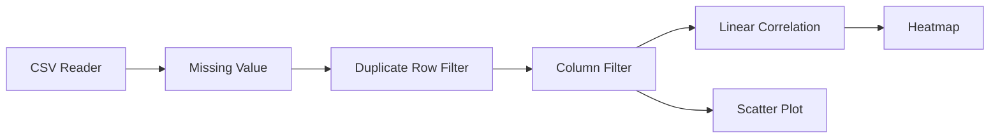
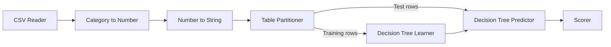
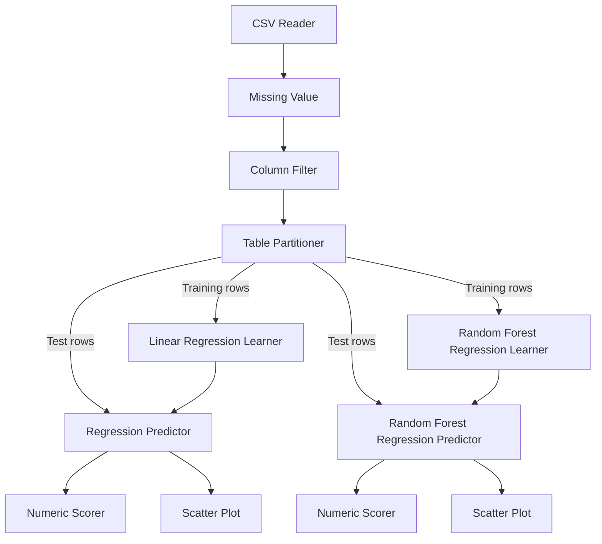

# KNIME + Python: A Practical Guide to Data Science & Machine Learning


[](https://github.com/Chetan-code-lrca/knime-vs-python-ml-guide/actions/workflows/tests.yml)

> Learn what KNIME does, what Python does, where they overlap, and how to choose the right tool by solving the same problem in both.

**Audience:** students, beginners, analysts, aspiring data scientists, and anyone wondering whether visual low-code tools make programming unnecessary.

**Status:** educational project in progress. The first shared case study and Python baseline are included; the KNIME workflow is documented as a build-along guide and should be exported and validated in a KNIME installation before being described as a ready-to-import workflow.

---

## The central idea

KNIME and Python are not two equivalent programming languages competing to do the same job.

- **KNIME Analytics Platform** is a visual workflow environment. You connect configurable nodes to read, transform, analyze, model, and visualize data.
- **Python** is a general-purpose programming language. Data-science libraries such as pandas and scikit-learn provide the operations used to build data and machine-learning workflows.
- **Machine learning knowledge** is the reasoning behind the work: choosing a target, avoiding leakage, selecting metrics, validating assumptions, and deciding whether a result is useful.

KNIME can handle many complete data-preparation and traditional ML workflows without requiring you to write much code. Python provides more direct control and a broad ecosystem for custom logic, experimentation, software integration, and production applications. KNIME can also integrate Python, so the two can be used together.

**The lesson is not “KNIME or Python?” It is “which tool fits this part of the job?”**

## Visual overview

The same machine-learning problem can be approached with two different interfaces. What matters is that both implementations follow sound data-science principles and are evaluated fairly.



### How to choose a tool



This is a starting guide, not a rigid rule. Team skills, governance, data size, deployment, maintenance, cost, and existing infrastructure can change the decision.

## What you will learn

By working through this repository, you will learn to:

1. Explain the difference between a visual analytics platform, a programming language, and an ML library.
2. Read a KNIME workflow as a sequence of data transformations.
3. Perform data cleaning, missing-value handling, feature preparation, model training, and evaluation in KNIME.
4. Perform equivalent steps using Python, pandas, and scikit-learn.
5. Understand why the same dataset can produce different results across tools.
6. Recognize data leakage, overfitting, weak baselines, and misleading metrics.
7. Decide when KNIME, Python, SQL, or a hybrid workflow is appropriate.

## Start here

| Step | Resource | What you will understand |
|---|---|---|
| 1 | [Learning path](docs/learning-path.md) | The recommended order for beginners |
| 2 | [KNIME in 10 minutes](docs/knime-in-10-minutes.md) | Nodes, ports, workflows, configuration, execution |
| 3 | [Python in 10 minutes](docs/python-in-10-minutes.md) | How Python libraries form a data-science workflow |
| 4 | [Tool decision guide](docs/decision-guide.md) | When to use KNIME, Python, SQL, or a combination |
| 5 | [ML workflow concepts](docs/ml-workflow-concepts.md) | Features, targets, splits, preprocessing, models, metrics |
| 6 | [KNIME ↔ Python mapping](docs/knime-python-node-map.md) | How common steps map between the two approaches |
| 7 | [Shared case study](tutorials/01-inventory-demand-case-study.md) | Build and compare the same regression task |
| 8 | [KNIME build-along](knime/README.md) | Construct the visual workflow step by step |
| 9 | [Why learn Python if KNIME exists?](docs/why-learn-python-if-knime-exists.md) | The role of coding, ML knowledge, and software engineering |
| 10 | [Preprocessing explained](docs/preprocessing-explained.md) | Missing values, encoding, scaling, feature engineering |
| 11 | [ML task types](docs/ml-task-types.md) | Regression, classification, clustering, forecasting |
| 12 | [Data leakage guide](docs/data-leakage.md) | Why preprocessing must be learned from training data only |
| 13 | [Glossary](docs/glossary.md) | Plain-language definitions of key terms |
| 14 | [Visual workflow gallery](docs/visual-workflows.md) | KNIME flowcharts from practical data-preparation and ML examples |

## Visual workflow examples

These diagrams are redrawn from selected KNIME practice-lab outputs supplied with the project work. They are separate examples—not the synthetic inventory-demand case study below.

### Data cleaning and exploration



A prepared table can branch into multiple analyses. This is useful when you want to reuse the same cleaned data for different visualizations or statistical checks.

### Classification with a decision tree



The partitioner separates training and test rows. The learner fits a model using training data; the predictor applies that fitted model to test data; the scorer evaluates predictions.

### Compare regression models



Using the same partition for both models makes the comparison more meaningful. See the [full visual workflow gallery](docs/visual-workflows.md) for notes on each diagram.

## The shared case study

We use a small, deterministic, **synthetic retail inventory-demand dataset**. The task is to estimate demand for the upcoming week using information available when a forecast is made.

- Dataset: [`data/inventory_demand.csv`](data/inventory_demand.csv)
- Data dictionary: [`data/DATA_DICTIONARY.md`](data/DATA_DICTIONARY.md)
- Dataset generator: [`data/generate_dataset.py`](data/generate_dataset.py)
- Python implementation: [`python/train_model.py`](python/train_model.py)
- Python notebook: [`python/side_by_side_demo.ipynb`](python/side_by_side_demo.ipynb)
- KNIME instructions: [`knime/README.md`](knime/README.md)

The CSV includes a `split` column. Both tools should use this column rather than independently generating a random split. That keeps the train/test rows identical across the two demonstrations.

### Quick results from the included Python baseline

The baseline script was executed with the checked-in dataset. Your exact values may differ slightly with library versions or workflow settings.

| Model | MAE | RMSE | R² |
|---|---:|---:|---:|
| Median baseline | 18.74 | 22.11 | -0.002 |
| Random Forest (Python) | 3.97 | 5.49 | 0.938 |

These results demonstrate that the synthetic data contains learnable patterns. They are **not** a benchmark proving Python is better than KNIME, and they do not indicate real-world forecasting performance.

## KNIME vs Python: a first look

| Question | KNIME Analytics Platform | Python ecosystem |
|---|---|---|
| How do you build a workflow? | Connect visual nodes | Write and execute code |
| How do you transform data? | Configure transformation nodes | Use pandas, NumPy, and other libraries |
| How do you train common ML models? | Configure learner nodes | Use scikit-learn estimators and pipelines |
| How do you inspect a workflow? | Follow nodes, ports, and their execution states | Read code, notebooks, logs, and tests |
| How much custom logic can you express? | Strong for supported nodes; extend with scripting and components | Very flexible through general-purpose code and libraries |
| How do you integrate with an application? | Use supported integrations, workflow services, or scripting | Build APIs, packages, jobs, and applications directly |
| Who benefits most? | People who value visual workflows, traceability, and accessible analytics | People who need programmability, automation, custom logic, or software integration |

Neither column is universally better. Complexity, team skills, governance, data size, deployment needs, budget, and maintenance requirements all matter.

## Run the Python example

Requirements: Python 3.10 or newer is recommended.

```bash
# 1. Clone the repository
git clone https://github.com/Chetan-code-lrca/knime-vs-python-ml-guide.git
cd knime-vs-python-ml-guide

# 2. Create and activate a virtual environment
python -m venv .venv

# Windows PowerShell
.venv\Scripts\Activate.ps1

# macOS / Linux
source .venv/bin/activate

# 3. Install dependencies
python -m pip install -r requirements.txt

# 4. Rebuild the dataset (optional; the CSV is already included)
python data/generate_dataset.py

# 5. Train and evaluate the model
python python/train_model.py

# 6. Run tests
pytest
```

To explore the notebook:

```bash
jupyter lab python/side_by_side_demo.ipynb
```

## Build the KNIME workflow

Install [KNIME Analytics Platform](https://www.knime.com/downloads). Then follow [`knime/README.md`](knime/README.md) to recreate the workflow from the same CSV.

The current guide uses the KNIME Base Nodes and KNIME Ensemble Learning Wrappers extension families. Node labels and availability can change between releases; check the node description in your installed version. The guide identifies the modern regression learner/predictor nodes rather than deprecated legacy variants.

## Learning principles used in this repository

- **Same task, same rows:** use the same target and the provided chronological split.
- **No leakage:** learn imputation values from training rows, then apply them to test rows.
- **Baseline first:** a complex model should be compared with a simple baseline.
- **Metrics need context:** MAE, RMSE, and R² answer different questions.
- **No tool wars:** implementation differences are not proof that one tool is universally superior.
- **Explain every step:** each tutorial should answer what it does, why it is needed, and when it is useful.

## Repository structure

```text
.
├── data/                  # Synthetic CSV, generator, and data dictionary
├── docs/                  # Beginner lessons, decision guides, and visual flowcharts
├── knime/                 # KNIME workflow build-along and node mapping
├── python/                # Python script, notebook, dependencies
├── tests/                 # Dataset and training smoke tests
├── tutorials/             # End-to-end learning exercises
└── .github/workflows/     # Automated tests
```

## Publishing and project roadmap

See [`PUBLISHING.md`](PUBLISHING.md) for the initial public-repository setup and [`ROADMAP.md`](ROADMAP.md) for planned learning modules.

## Contributing

Beginners are welcome. You do not need to be an expert to improve a beginner guide. Start with [`CONTRIBUTING.md`](CONTRIBUTING.md), open an issue for unclear steps, or submit a small correction with a reproducible example.

## Sources and further learning

- [KNIME Analytics Platform overview](https://www.knime.com/knime-analytics-platform)
- [KNIME getting started guide](https://www.knime.com/getting-started-guide)
- [KNIME nodes and workflows](https://docs.knime.com/build/nodes-workflows/)
- [KNIME Python integration](https://docs.knime.com/ap/latest/python_installation_guide/)
- [scikit-learn getting started](https://scikit-learn.org/stable/getting_started.html)
- [pandas getting started](https://pandas.pydata.org/docs/getting_started/index.html)

## License

The source code and educational material are released under the MIT License. The synthetic dataset is generated by this repository and may be reused under the same license. See [LICENSE](LICENSE).
