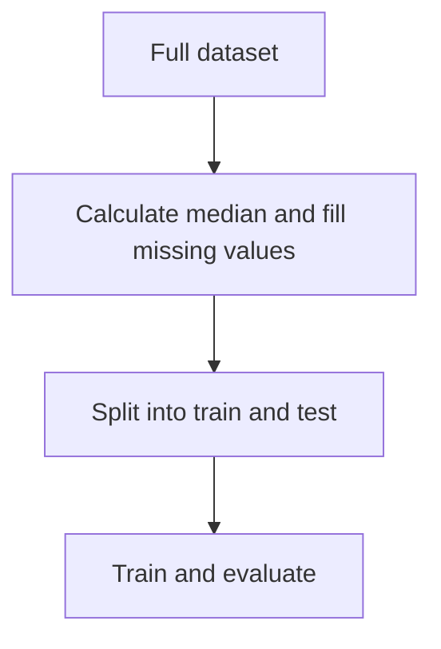
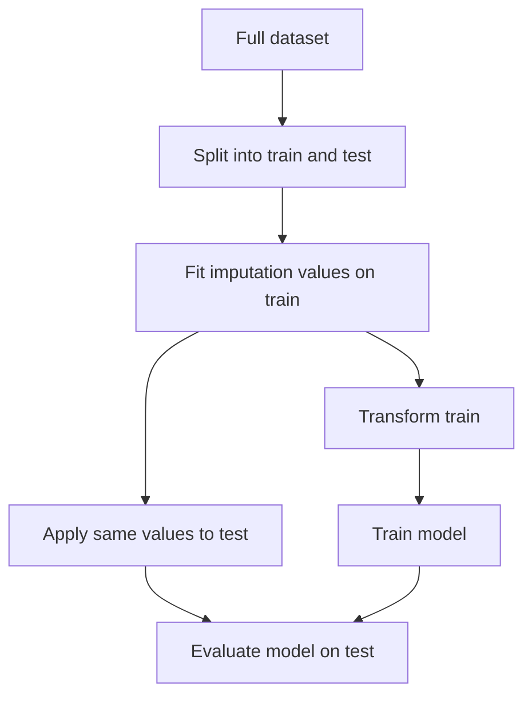

# Data leakage: a mistake to avoid in both KNIME and Python

## What is data leakage?

Data leakage occurs when information that would not legitimately be available at model-training or prediction time influences the learned model or the evaluation. It can make test performance look better than it really is.

## Example: imputing before splitting

Suppose the full dataset contains missing values in `price_next_week`.

**Unsafe sequence:**

The median was calculated using both training and test rows. Test data has influenced a preprocessing decision.

**Safer sequence:**

The test set must not be used to estimate the median, most-frequent category, scaling parameters, feature selection criteria, or other learned preprocessing decisions.

## In Python

Put preprocessing inside a scikit-learn `Pipeline`. When `.fit()` is called on the training set, the imputer and encoder learn from training data. The subsequent `.predict()` call applies those fitted transformations to the test data.

See `python/train_model.py` for the full example using `ColumnTransformer` and separate numeric/categorical pipelines.

## In KNIME

Use the training subset to configure/learn the missing-value transformation. The modern **Missing Value** node provides an output containing the replacement transformation (PMML). Connect that transformation to **Missing Value (Apply)** and apply it to the held-out test rows. Do not calculate replacement statistics independently on the test set.

Similarly, when applying a learned normalization, use the training-fitted model with **Normalizer Apply (PMML)** for the test data.

The exact node labels and available ports may vary with the KNIME version and installed extensions. Inspect the current node description before building the flow.

## Other leakage examples

- Including a future outcome or post-event field as a model feature.
- Randomly splitting time-series rows when the real task is to predict future periods.
- Duplicates or repeated entities appearing in both train and test when the intended evaluation is on unseen entities.
- Choosing features or hyperparameters repeatedly based on the test score.
- Using a target-derived column without realizing it contains the answer.

## Questions to ask

1. Would this feature exist at the exact moment a prediction is made?
2. Was any preprocessing parameter estimated using test rows?
3. Does the split reflect the way the model will be used in the real world?
4. Have I used the test set to repeatedly tune the model?
