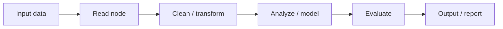

# KNIME in 10 minutes

## What is KNIME Analytics Platform?

KNIME Analytics Platform is an open-source visual environment for building data-science workflows. Instead of writing every operation as code, you assemble a flow from configurable nodes.

A node can read a file, filter rows, transform columns, train a model, make predictions, or visualize results. Nodes pass data or model objects through connections called ports.

## The mental model

Each box represents one or more nodes. The workflow makes the order and connections visible.

## Your first workflow

1. Install [KNIME Analytics Platform](https://www.knime.com/downloads).
2. Open a new workflow.
3. Search for a file-reading node such as **CSV Reader** and add it to the canvas.
4. Configure the input file path and execute the node.
5. Open its output table and inspect the column names and data types.
6. Add a node such as **Column Filter** or **Row Filter**.
7. Connect the output port of the reader to the input port of the transformation node.
8. Configure and execute the new node.
9. Add a visualization or writer node to inspect or save the output.

The exact node list depends on the installed KNIME version and extensions. The [official getting started guide](https://www.knime.com/getting-started-guide) walks through the current interface.

## Vocabulary

| Term | Meaning |
|---|---|
| Node | One operation in a workflow |
| Port | An input or output interface on a node |
| Connection | Transfers data or a model between nodes |
| Workflow | The graph of connected operations |
| Component | A reusable group of nodes packaged as one unit |
| Extension | An installable set of additional nodes or capabilities |
| Flow variable | A value used to control or parameterize workflow execution |

## Why people use it

KNIME is useful when:
- A data task can be expressed as a sequence of known operations.
- A team benefits from visually inspecting and discussing the flow.
- Analysts need to combine files, databases, and other data sources.
- Repeatable data preparation or reporting needs to be automated.
- Someone needs to prototype a standard ML workflow without writing the entire pipeline from scratch.

## What it does not remove

A visual interface does not remove the need to understand data types, sampling, statistical assumptions, model evaluation, bias, leakage, and business context. A node can be misconfigured just as code can be incorrect.

## KNIME and Python can work together

KNIME provides Python integration for executing Python scripts inside workflows. That means a practical workflow can use KNIME for orchestration and visibility, then use Python where custom code or a particular library is useful. See the [KNIME Python Integration guide](https://docs.knime.com/ap/latest/python_installation_guide/).

## Mini exercise

Open `data/inventory_demand.csv` and identify:
- Which column is the target?
- Which column tells you whether a row belongs to training or testing?
- Which columns are identifiers or context rather than model inputs?
- Which columns contain missing values?

Do not train a model yet. First explain what each column means using the [data dictionary](../data/DATA_DICTIONARY.md).
