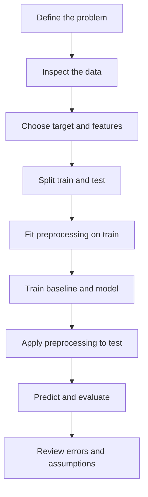

# The machine-learning workflow, explained

This page describes the reasoning that sits underneath both KNIME nodes and Python code.

## 1. Define the prediction problem

Write the problem in one sentence. In the shared case study:

> Estimate next week's demand from information available at forecast time.

A precise problem statement helps determine the target, allowed inputs, split strategy, and metric.

## 2. Identify features and target

- **Features (`X`):** input columns used to make a prediction.
- **Target (`y`):** the value the model learns to predict.

In this repository, the target is `demand_next_week`. Example features include `product_category`, `region`, `price_next_week`, and recent demand history.

Never include the target itself in the features. Avoid identifiers or fields that only reveal the answer indirectly.

## 3. Inspect before transforming

Check:
- Number of rows and columns.
- Data types and category values.
- Missing values and duplicate records.
- Unexpected ranges and outliers.
- Whether the target is usable and correctly defined.
- Whether features would actually be available at prediction time.

## 4. Split the data

Training data is used to fit preprocessing steps and model parameters. Test data is held back to estimate performance on unseen observations.

The example uses a chronological split because the scenario is forecasting. It uses the same `split` labels in both tools.

## 5. Preprocess the data

Typical tasks include:
- Imputation: handle missing values.
- Encoding: represent categorical values in a form the model can use.
- Scaling: adjust numeric feature ranges when an algorithm benefits from it.
- Feature selection or creation: use relevant inputs and construct useful derived values.

Not every algorithm needs every transformation. For example, random forests generally do not require standard scaling, while distance-based methods and many linear models can be sensitive to feature scale.

## 6. Train a baseline and a model

A baseline is a simple reference, such as predicting the training-set median for every observation in a regression problem. A model should provide value beyond a simple reference.

The Python script includes a median baseline and a Random Forest regressor. The KNIME guide focuses on reproducing the Random Forest regression workflow.

## 7. Evaluate on held-out data

For this regression task:

| Metric | What it tells you | Caution |
|---|---|---|
| MAE | Average absolute prediction error, in target units | Does not emphasize large errors as strongly as RMSE |
| RMSE | Error in target units, penalizing larger errors more heavily | Can be dominated by a few large errors |
| R² | Relative fit compared with predicting the test-set mean | Can be negative; it is not a percentage of predictions that are correct |

No metric alone tells you whether a model is useful. Consider the cost of over- and under-prediction, data quality, uncertainty, and the intended decision.

## 8. Validate and maintain

Before calling a model useful, test more than one split or time period where appropriate, inspect errors, compare with a baseline, and document assumptions. A deployed model also needs monitoring for changes in data and performance.

## Workflow overview

