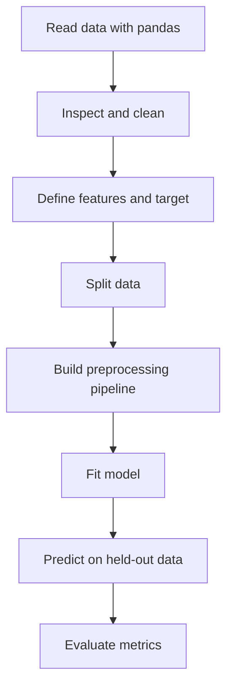

# Python in 10 minutes

## Python is the language, not the whole data-science stack

Python is a general-purpose programming language. Data-science work commonly combines Python with libraries:

| Library | Typical role |
|---|---|
| NumPy | Numerical arrays and numerical operations |
| pandas | Tabular data loading, cleaning, joining, grouping, and analysis |
| Matplotlib | Plotting and visualization |
| scikit-learn | Classical ML estimators, preprocessing, pipelines, validation, and metrics |
| PyTorch | Deep-learning model development |

The language provides the syntax and execution environment. Libraries provide reusable functionality.

## A typical code-first workflow



## Install the example environment

From the repository root:

```bash
python -m venv .venv

# Windows PowerShell
.venv\\Scripts\\Activate.ps1

# macOS / Linux
source .venv/bin/activate

python -m pip install -r requirements.txt
```

## Read a CSV with pandas

```python
import pandas as pd

frame = pd.read_csv("data/inventory_demand.csv")
print(frame.head())
print(frame.info())
print(frame.isna().sum())
```

## Train a model with scikit-learn

The full implementation is in [`../python/train_model.py`](../python/train_model.py). The important pattern is that preprocessing and the estimator are assembled into a `Pipeline`.

```python
from sklearn.ensemble import RandomForestRegressor
from sklearn.impute import SimpleImputer
from sklearn.pipeline import Pipeline

pipeline = Pipeline([
    ("imputer", SimpleImputer(strategy="median")),
    ("model", RandomForestRegressor(random_state=42)),
])
```

This small example is for numeric columns. The repository's full pipeline uses a `ColumnTransformer` so numeric and categorical columns can receive different preprocessing.

## Why code-first is useful

Python is especially useful when:
- You need custom feature engineering or algorithms.
- You want to use a library that is not available as a native node.
- You are experimenting rapidly with code, notebooks, and tests.
- The workflow must become a package, API, application, or software service.
- You need detailed control over execution, versioning, automation, and integration.

## What Python does not solve automatically

Writing code does not guarantee a correct result. You still need to choose suitable data, avoid leakage, test assumptions, evaluate on unseen observations, document the pipeline, and monitor a deployed model.

## Mini exercise

Run:

```bash
python python/train_model.py
```

Find the `features` list in the output. Explain why `week_index`, `store_id`, `week_start`, `split`, and the target itself are not passed to the estimator.
