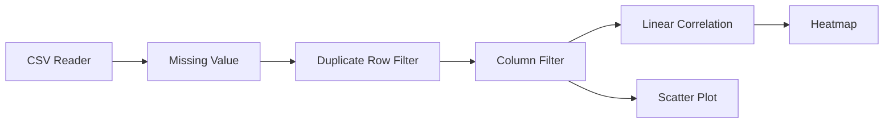
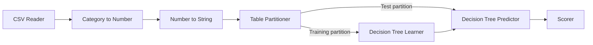
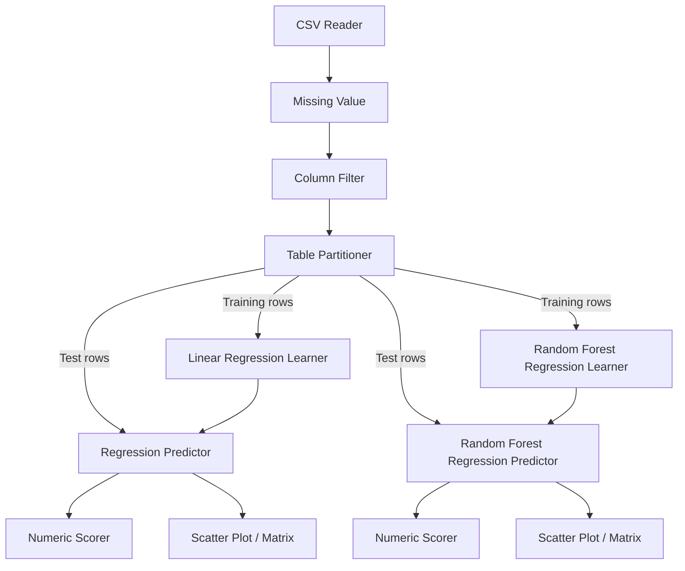
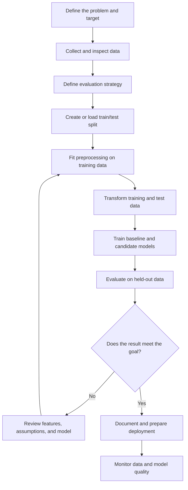
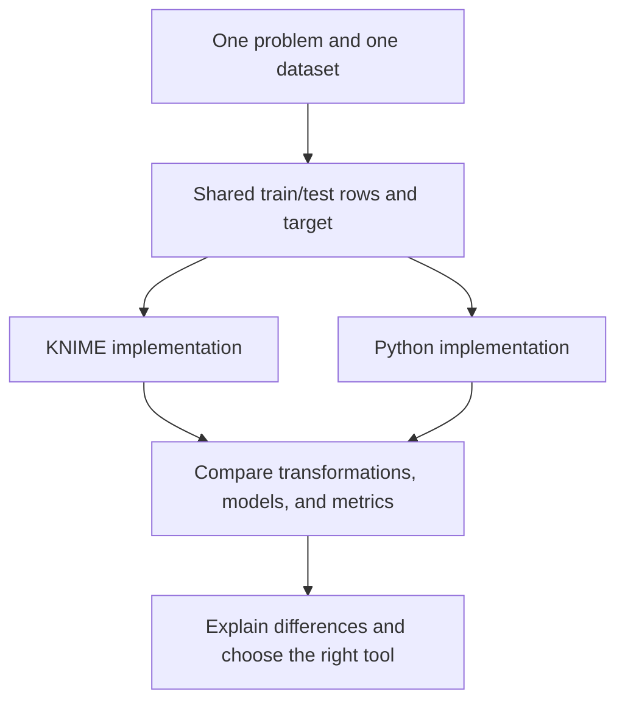

# Visual workflow gallery

This page redraws selected KNIME practice workflows as Mermaid diagrams so that the flow is readable directly on GitHub. The examples are based on the screenshots in the supplied KNIME output archive. They are **separate practice workflows** and should not be confused with the synthetic inventory-demand case study in this repository.

## 1. E-commerce customer behaviour: data cleaning and exploration

The workflow shown in Lab 12 reads a transaction table, handles missing values, removes duplicate rows, and selects columns. The cleaned table then branches into correlation analysis and a scatter plot.

**What to notice:** KNIME workflows can branch. A single prepared table can feed multiple analyses without repeating the earlier cleaning steps.

## 2. Predictive maintenance: decision-tree classification

The Lab 14 workflow converts categorical values into numeric values, converts selected numeric columns to strings where required by the workflow, partitions the rows, trains a decision tree on one partition, and applies it to the held-out partition before scoring.

**What to notice:** The partitioner has two outputs with different purposes. The learner sees training rows; the predictor receives the test rows and the trained model.

## 3. Student performance: compare regression models

The Lab 15 workflow prepares the table, partitions it, and trains two regression approaches in parallel. Each trained model predicts the held-out rows, and numeric scorers and plots are used to inspect the results.

**What to notice:** Model comparison is easier to understand when both candidates use the same partition. Compare metrics on the same held-out rows rather than comparing unrelated runs.

## 4. Generic machine-learning workflow: the safe order

This is the high-level order used throughout this learning guide. The split happens before learned preprocessing so that information from the test data does not influence the training pipeline.

## 5. KNIME and Python: two ways to implement the same work

The diagrams are conceptual guides, not substitutes for examining node settings, code, data types, or validation details. In the hands-on tutorials, inspect each transformation and verify that both implementations use equivalent data and evaluation rules.
