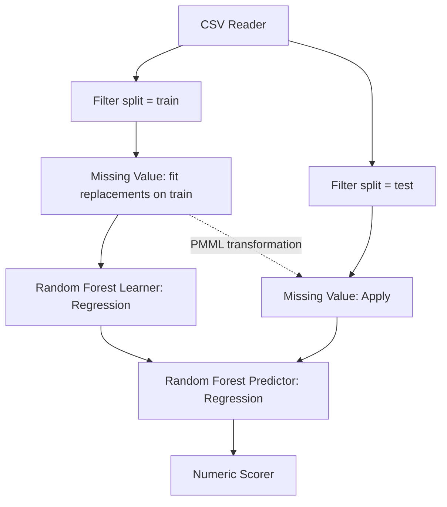

# Case study 01: predict next week's inventory demand

## Scenario

A retailer wants an estimate of next week's demand for each store/product combination. Available information includes recent demand, product category, store region and format, planned price, discount, promotion, and a holiday flag.

This is a **regression** problem because the target is numeric: `demand_next_week`.

> This is a synthetic teaching exercise. It does not represent an actual retailer or provide an operational inventory recommendation.

## Step 1 — Understand the data

Read [`../data/DATA_DICTIONARY.md`](../data/DATA_DICTIONARY.md). The CSV contains 3,120 rows generated by the included script. Selected input columns contain missing values on purpose.

The `split` column assigns the earliest 80% of weeks to `train` and the final 20% to `test`. Both implementations must use this column so they evaluate on the same rows.

```python
import pandas as pd

frame = pd.read_csv("data/inventory_demand.csv")
print(frame.shape)
print(frame.head())
print(frame.isna().sum().sort_values(ascending=False))
print(frame["split"].value_counts())
```

Questions:
- What are the input features?
- Which column is the target?
- Why should `week_index`, `week_start`, `store_id`, and `split` be excluded from model inputs in this starter experiment?
- Why is the chronological split more appropriate than shuffling all weeks for this forecasting demonstration?

## Step 2 — Run the Python implementation

From the repository root:

```bash
python -m pip install -r requirements.txt
python python/train_model.py
```

The script:
1. Loads and validates the CSV.
2. Filters the pre-defined training and test periods.
3. Excludes IDs and split metadata from the feature set.
4. Imputes numeric features with the training median.
5. Imputes categorical features with the training most-frequent value.
6. One-hot encodes categorical values.
7. Fits a Random Forest regressor.
8. Evaluates predictions on the test period using MAE, RMSE, and R².
9. Compares the model to a median baseline.

The preprocessing steps are inside a scikit-learn `Pipeline`, so their fitted values come from the training subset only.

## Step 3 — Build the KNIME implementation

Follow [`../knime/README.md`](../knime/README.md). In summary:



Also remove `week_start`, `week_index`, `store_id`, and `split` from the model attributes. Keep `demand_next_week` as the target column for training and as the reference column for scoring.

## Step 4 — Compare the implementations

Compare the following, not just one metric:

| Comparison | What to inspect |
|---|---|
| Workflow construction | Nodes and connections vs code and pipeline objects |
| Preprocessing | Where missing-value rules are learned and how they are applied |
| Categorical data | Native nominal handling vs one-hot encoding |
| Model setup | Number of trees, random seed, and other supported parameters |
| Evaluation | Same test rows, target, and MAE/RMSE/R² definitions |
| Reproducibility | Saved workflow/configuration, package versions, and random seed |
| Debugging | Node configuration/execution state vs stack traces/logging/tests |

Do not expect identical numbers automatically. The two implementations can use the same data and model family while differing in categorical representation, algorithm details, defaults, and version-specific behavior.

## Step 5 — Interpret the metrics

- MAE is the average absolute error, measured in units of demand.
- RMSE is also measured in demand units, but larger mistakes have more influence.
- R² describes performance relative to predicting the test target mean. It can be negative.

Discuss whether the error would be acceptable for a real inventory decision. The synthetic exercise alone cannot answer that question.

## Step 6 — Experiments

Try these one at a time and record what changes:

1. Train without `previous_week_units` and `avg_4_week_units`.
2. Train without promotion and discount features.
3. Replace the Random Forest with a linear regression model.
4. Change the number of trees and compare training time and test error.
5. Change the time split and inspect how robust the result is.
6. Try a different missing-value strategy.
7. Create a simple visual report of actual versus predicted demand.

For each experiment, write down the hypothesis before running it. This helps distinguish deliberate experimentation from random parameter changes.

## Reflection

Answer these in your own words:

- What did KNIME make easier to see?
- What did Python make easier to customize?
- Which step was conceptually the same in both tools?
- Which differences came from the tools, and which came from model configuration?
- What would you change before using a model in a real business?
